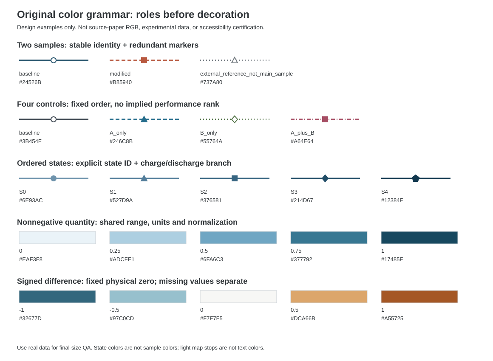

# Sodium Polyanion Mentor

钠离子电池聚阴离子正极科研指导技能：把文献阅读经验转化为可检索、有条件边界的研究决策方法。

面向 NFPP、磷酸盐/焦磷酸盐、NASICON、氟磷酸盐和硫酸盐正极改性研究，支持文献检索与阅读、创新构思、合成与表征规划、论文论证、组图顺序及配色建议。它不是自动证明机制、保证创新性或保证录用的工具。

## 能做什么

- 将改性想法转化为可证伪问题，识别最小对照、共变因素和优先补强的检测。
- 根据已有证据选择论文主线，规划段落递进和主图/面板职责，不强套固定图数。
- 提供原创颜色角色映射，区分类别、状态和连续量，保留文献配色来源的不确定性。
- 生成可接续的检索计划，规范化 DOI、去重候选并对照历史记录；区分计划、实际检索、正文阅读和知识迁移。
- 用轻量工具检查主张—证据—图组引用、状态可比性、数据来源独立性与颜色角色冲突。

## 如何使用

将本仓库目录放入兼容客户端的技能目录，目录名保持为 `sodium-polyanion-mentor`。例如 Codex 的用户技能位置为 `.codex/skills/sodium-polyanion-mentor`。

在对话中调用：

```text
使用 $sodium-polyanion-mentor，根据我已有的证据，提出最能成立的创新主线、优先补做的检测和主图顺序。需要文献支持的判断请给对应 DOI，不用全文。
```

助手按当前问题读取必要模块；不需要提问者填写 JSON。支持中文讨论和按需英文稿句。

## 核心规则

1. 依赖文献证据的创新建议或论证判断，给出匹配 DOI，并说明支持范围；不交付论文全文。
2. 纯写作组织、组图顺序直接给建议，不默认堆列论文案例；需要时再给参考。
3. 无直接支持时明确标注理论推演及前提，不编造或硬配 DOI；知识库没有不等于领域不存在。
4. 正文、图注、图面与 SI 的阅读状态分别记录；图注不能冒充视觉核验。
5. 不包含私人研究材料或论文原图；历史近似颜色与原创方案不冒充原作者精确源色。

## 内部结构

| 部分 | 内容 |
| --- | --- |
| `SKILL.md` | 任务路由、使用原则与输出边界 |
| `data/knowledge.json` | 24 条条件式决策规则与 7 种叙事路径 |
| `data/corpus.json` | 159 条历史文献身份、阅读深度与资格状态 |
| `data/colors.json` | 47 条历史配色观察与 5 套原创方案 |
| `references/` | 按需调用的研究、论证、配色、检索和阅读方法 |
| `scripts/` | 本地规则检索、轻量检查、检索计划与候选去重 |

159 是历史身份数，不表示近五年文献已经穷尽，也不表示所有文章均读过全部图片或 SI。隔离条目不用于科学建议。规则附带的 DOI 是可追溯线索，不能省略对具体主张支持关系的核验。

## 本地辅助工具

工具仅依赖 Python 标准库，在仓库根目录运行：

```bash
python -X utf8 -B scripts/mentor.py query "第二相 物理混合" --mode innovation --limit 3
python -X utf8 -B scripts/mentor.py palette categorical
python -X utf8 -B scripts/mentor.py audit assets/task-example.json
python -X utf8 -B scripts/search_workflow.py plan --family nasicon --family nfpp --from-date 2024-01-01 --until-date 2026-10-21
python -X utf8 -B scripts/test_mentor.py
```

日期是示例，按实际任务修改。`plan` 不联网；`screen` 只处理传入候选。两者不报告未执行的搜索，也不把候选标为全文已读。示例任务为虚构教学输入。

v1.0.0 的 26 项行为与完整性检查通过；这些检查不认证科学结论、引文支持或领域覆盖。检查器的 `scientific_acceptance` 始终为 `false`。

## 原创配色预览



仅示范颜色语义与冗余编码，不是论文原图或实验数据；未认证作者源色、色觉可访问性或印刷效果。自定义状态标签不自动确立 SOC 顺序，同 SOC 的颜色编码需在真实取态定义确认后统一。

## 内容与权限边界

本仓库不提供论文全文、订阅图片、浏览器登录信息或私人研究文件。源论文与软件工具的权利不因出现在 DOI 或名称中而转移。本版本未附开源许可证；公开仓库与指定开源许可证是不同事项。

技能调用不自动恢复暂停任务，也不自动把新的用户研究数据写回知识库。需要新证据时按当前任务和权限补查，并保留来源与不确定性。
